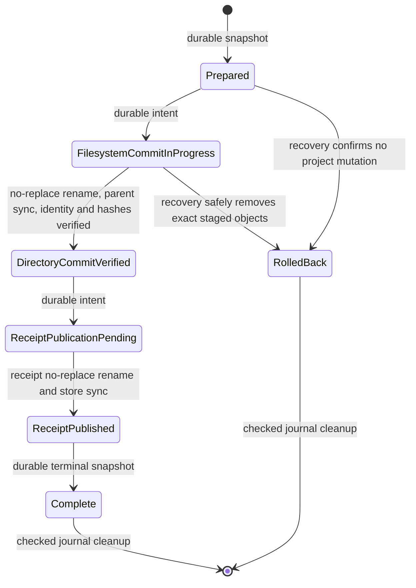

# Installation recovery

M2-06 adds an internal recovery protocol for Codex project skills. The CLI still requires
`skills install --dry-run`; public writes remain disabled until independent architectural review.
The recovery implementation has no network dependency and tests use isolated application-data
and project directories.

## Journal storage and schema

Operation records live in the application-data `operations` directory, beside and separate from
`receipts` and the catalog cache. Each operation is a sequence of immutable JSON snapshots named
`op-<random-128-bit-id>-<zero-padded-sequence>.json`. Schema version 1 rejects unknown fields,
unsupported versions, malformed names, missing or duplicate sequence entries, unsafe object types,
invalid receipt data, and records larger than 10 MiB. The store is bounded to 16,384 entries and
256 MiB total; inventory paths and record counts are validated against the receipt and archive
limits. Capacity exhaustion fails closed and can leave an explicitly incomplete operation for
recovery or manual inspection.

Every snapshot carries the strict schema-v1 receipt identity and full expected receipt, operation
ID and sequence, state, destination-local staging name, project `.agents` and `skills` identities,
whether THRN intended to create those parents, the staging and final directory identities, and the
relative paths and filesystem identities of operation-created files and directories. The receipt
supplies the expected path inventory, file sizes, and SHA-256 hashes. A file record also marks
whether the complete staged file was verified before commit. Journal contents and receipts are
both untrusted and neither is sufficient evidence by itself.

Each snapshot is written to an exclusive unpredictable temporary file, flushed, synchronized,
parsed back under the strict schema, and published with the existing platform no-replace file
rename. The journal directory is synchronized where supported. Snapshots are append-only while an
operation is live; terminal cleanup removes them only after final receipt or rollback state has
been checked. Cleanup durably removes older snapshots while retaining the terminal snapshot, then
removes and synchronizes the terminal snapshot. Failed cleanup leaves terminal state for a later
retry. A truncated/pending journal
publication is preserved and blocks recovery rather than being treated as no operation.

## State machine and ordering

The receipt store's exclusive OS file lock is acquired before preparation, held across directory
commit, receipt publication, recovery, and cleanup. `Prepared` is durably published before any
project mutation. `FilesystemCommitInProgress` is durably published before creating destination
parents or staging content. Directory and file identities are journaled as each operation-owned
object is created. Copied files are synchronized and hashed before being marked verified. The final
directory is committed with Linux `renameat2(RENAME_NOREPLACE)`, macOS `renameatx_np(RENAME_EXCL)`,
or Windows `FileRenameInfoEx` with replacement disabled; unsupported primitives fail closed. Its
parent directory is synchronized where supported before the journal records `DirectoryCommitVerified`.

`ReceiptPublicationPending` is durable before receipt-temp creation. The receipt is exclusively
created, fully written, synchronized, read back and validated, then published without replacement;
the receipt directory is synchronized where supported before `ReceiptPublished`. The complete
receipt and destination are validated again before recording `Complete`. Success is returned only
after the receipt is valid, required synchronization has succeeded, the terminal journal state is
durable to the supported level, and journal cleanup succeeds. If cleanup fails, the call reports an
incomplete result even though the valid receipt remains; recovery verifies the terminal record and
retries cleanup.

## Recovery decisions and rollback limits

Recovery first strictly reads the bounded journal, then acquires the same OS writer lock as install.
Before each action it opens project components without following links, checks project and parent
directory identities, verifies the operation's staging/final identity, inventories every current
file and directory, hashes files, validates receipt identity and contents, and checks for other
receipt claims. It uses secure directory handles and no-replace operations. Recovery is idempotent:
it rechecks current state on every attempt and only advances or cleans a record after successful
verification.

- `Prepared`: no project mutation is permitted by ordering. Recovery marks it rolled back and
  removes the terminal record after validation.
- `FilesystemCommitInProgress`, final destination absent: only a staging tree whose root, every
  object identity, exact inventory, and complete file hashes match the journal can be removed.
  Created `.agents` or `skills` parents are removed only if their recorded identities still match
  and they are empty. Before each removal, recovery durably records an object-specific cleanup
  intent, rechecks identity and contents, removes the object, then synchronizes the containing
  directory where supported. A missing object is tolerated only where that exact cleanup intent
  is present, so a later recovery can distinguish its own prior removal from unexpected loss.
- `FilesystemCommitInProgress`, final destination present: recovery finalizes only if its identity
  is the recorded staging identity and its exact inventory and all receipt hashes verify.
- `DirectoryCommitVerified` or `ReceiptPublicationPending`: recovery verifies destination and
  project identities and all hashes, synchronizes the parent where supported, then publishes the
  exact receipt or recognizes an already-published identical receipt. A conflicting receipt is
  never overwritten.
- `ReceiptPublished`: the published receipt and destination must still exactly match before
  recovery records completion.
- `Complete` or `RolledBack`: terminal facts are rechecked before journal cleanup is retried.

Modified or partial files, missing or extra entries, changed project/destination identities,
symlinks/reparse points, unrecorded objects, corrupt receipts, malformed temporary receipts,
conflicting claims, changed parent directories, or uncertain ownership produce an actionable
conflict. Recovery preserves the uncertain content and journal state. In particular, a crash after
an object is created but before its filesystem identity is durably recorded cannot establish
ownership; recovery reports a conflict. Partial file copies have a recorded object identity but do
not match the expected full hash, so they are preserved for manual inspection. THRN does not infer
ownership from a pathname or recursively delete a destination.

## Concurrency and durability

`.writer.lock` is a persistent empty regular file. Exclusivity comes from the OS file lock, not file
age or stored PID. A lock that another process still holds blocks both install and recovery. After
process termination the OS releases the lock; the lock file remains and can be reacquired after its
type, contents, and identity are checked. THRN never removes a stale-looking lock based only on age
or PID. OS/filesystem lock semantics must be honored by the underlying filesystem; errors fail
closed. The single receipt store lock serializes internal operations using the same THRN data
directory, including operations for different projects.

Process-interruption recovery is stronger than power-loss guarantees. On Linux and macOS, the
implementation synchronizes journal and receipt files, destination files, and containing directory
entries before advancing corresponding states. Windows file contents are synchronized, but the
current secure directory-handle layer cannot portably flush directory-entry metadata; a sudden
power loss can therefore lose a rename/create even after the journal records the best available
state. On every platform, project content and application data may be on separate filesystems, and
there is no atomic commit spanning them. The protocol revalidates after restart and reports missing
or conflicting evidence; it does not claim power-loss atomicity. Unsupported required filesystem
operations fail closed.

## Read-only listing and troubleshooting

`skills list --installed` remains offline and read-only. It lists validated receipts only and does
not invoke recovery, delete journal files, repair receipt storage, or claim ownership of an
unreceipted directory. It does not validate current project contents. Internal recovery status is
not currently exposed as a public command.

When an internal recovery attempt reports a conflict, preserve the project tree, receipt store, and
`operations` directory as found. Record the operation ID and actionable error for the architect or
maintainer. Do not delete a skill directory, `.writer.lock`, `.pending-*` file, receipt, or journal
because its name looks temporary or stale. Do not copy an unreceipted directory into the managed
list. A retry is safe only through THRN's recovery API after the underlying cause is understood;
conflicts require inspection and an explicit recovery decision.
