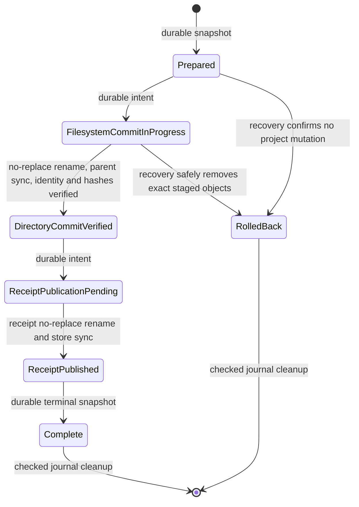

# Installation, update, and removal recovery

M2-06 introduced the recovery protocol for Codex project installation. M3-04 extends the same
receipt store, OS-backed writer lock, staging, no-replace commitment, removal quarantine, update
backup, and recovery paths to explicitly selected Codex user scope. `thrn skills install` enters it
through `InstallationSession::commit_and_record`; recovery itself has no network dependency and
tests use isolated application-data, project, and home directories.

## Scope-bound recovery

Project operations retain their original journal formats and resolve the selected project root.
Explicit user operations resolve the validated OS home and require receipt scope, canonical root,
root filesystem identity, destination, and journal identities to agree. User install, removal, and
update journals use schema version 2; project journals retain their existing schema version 1. A
record cannot switch scope during recovery. The selected skill destination is
`<project>/.agents/skills/<skillName>` or `<home>/.agents/skills/<skillName>`. User operations do
not use the current working directory or legacy `$CODEX_HOME/skills` as a fallback. Both scopes
hold the same `.writer.lock` through recovery and transaction completion.

## Journal storage and schema

Operation records live in the application-data `operations` directory, beside and separate from
`receipts` and the catalog cache. Each operation is a sequence of immutable JSON snapshots named
`op-<random-128-bit-id>-<zero-padded-sequence>.json`. Project schema version 1 and user schema
version 2 reject unknown fields,
unsupported versions, malformed names, missing or duplicate sequence entries, unsafe object types,
invalid receipt data, and records larger than 10 MiB. The store is bounded to 16,384 entries and
256 MiB total; inventory paths and record counts are validated against the receipt and archive
limits. Capacity exhaustion fails closed and can leave an explicitly incomplete operation for
recovery or manual inspection.

Every snapshot carries a strict receipt identity and full expected receipt, operation ID and
sequence, state, destination-local staging name, selected-root `.agents` and `skills` identities, whether
THRN intended to create those parents, the staging and final directory identities, and the relative
paths and filesystem identities of operation-created files and directories. A new operation begins
with a scope-specific receipt intent needed for reservation. After the no-replace commit, the journal
records the committed destination identity and matching project schema-v2 or user schema-v3 receipt
together before it can advance to `DirectoryCommitVerified`. The receipt's identity must equal the
journal's destination identity. Historical project v1 journal snapshots remain readable; they keep
their original strict receipt data until recovery can prove an in-progress installation from its
recorded staging identity. The
receipt supplies the expected path inventory, file sizes, and SHA-256 hashes. A file record also
marks whether the complete staged file was verified before commit. Journal contents and receipts are
both untrusted and neither is sufficient evidence by itself.

Each snapshot is written to an exclusive unpredictable temporary file, flushed, synchronized,
parsed back under the strict schema, and published with the existing platform no-replace file
rename. The journal directory is synchronized where supported. Snapshots are append-only while an
operation is live; terminal cleanup removes them only after final receipt or rollback state has
been checked. Cleanup durably removes older snapshots while retaining the terminal snapshot, then
removes and synchronizes the terminal snapshot. Failed cleanup leaves terminal state for a later
retry. A truncated/pending journal
publication is preserved and blocks recovery rather than being treated as no operation.

## State machine and ordering

Recovery opens or safely creates the receipt-store directory, acquires and validates its exclusive
OS file lock, and only then reads and validates bounded journal snapshots. The same lock remains
held through recovery mutations, receipt publication, journal cleanup, and result determination.
On an error, the implementation attempts an explicit release and the lock owner retries on drop if
needed. `Prepared` is durably published before any project mutation.
`FilesystemCommitInProgress` is durably published before creating destination
parents or staging content. Directory and file identities are journaled as each operation-owned
object is created. Copied files are synchronized and hashed before being marked verified. The final
directory is committed with Linux `renameat2(RENAME_NOREPLACE)`, macOS `renameatx_np(RENAME_EXCL)`,
or Windows `FileRenameInfoEx` with replacement disabled; unsupported primitives fail closed. Its
parent directory is synchronized where supported. THRN then captures the committed directory
identity through the secure handle layer and durably records it with the upgraded v2 receipt before
the journal records `DirectoryCommitVerified`.

`ReceiptPublicationPending` is durable before receipt-temp creation. The receipt is exclusively
created, fully written, synchronized, read back and validated, then published without replacement;
the receipt directory is synchronized where supported before `ReceiptPublished`. The complete
receipt and destination are validated again before recording `Complete`. Success is returned only
after the receipt is valid, required synchronization has succeeded, the terminal journal state is
durable to the supported level, and journal cleanup succeeds. If cleanup fails, the call reports an
incomplete result even though the valid receipt remains; recovery verifies the terminal record and
retries cleanup.

## Recovery decisions and rollback limits

Recovery acquires the same OS writer lock as install before strictly reading the bounded journal.
Before each action it opens project components without following links, checks project and parent
directory identities, verifies the operation's staging/final identity, inventories every current
file and directory, hashes files, validates receipt identity and contents, and checks for other
receipt claims. It uses secure directory handles and no-replace operations. Recovery is idempotent:
it rechecks current state on every attempt and only advances or cleans a record after successful
verification.

- `Prepared`: no project mutation is permitted by ordering. Recovery marks it rolled back and
  removes the terminal record after validation.
- `FilesystemCommitInProgress`, final destination absent: only a staging tree whose root, every
  object identity, exact inventory, and complete file hashes match the journal can be removed.
  Created `.agents` or `skills` parents are removed only if their recorded identities still match
  and they are empty. Before each removal, recovery durably records an object-specific cleanup
  intent, rechecks identity and contents, removes the object, then synchronizes the containing
  directory where supported. A missing object is tolerated only where that exact cleanup intent
  is present, so a later recovery can distinguish its own prior removal from unexpected loss.
- `FilesystemCommitInProgress`, final destination present: recovery finalizes only if its identity
  is the recorded staging identity and its exact inventory and all receipt hashes verify. An
  interrupted legacy operation can bind v2 evidence only after this identity comparison; an
  already-published v1 receipt is never rewritten.
- `DirectoryCommitVerified` or `ReceiptPublicationPending`: recovery verifies destination and
  project identities and all hashes, synchronizes the parent where supported, then publishes the
  exact receipt or recognizes an already-published identical receipt. A conflicting receipt is
  never overwritten.
- `ReceiptPublished`: the published receipt and destination must still exactly match before
  recovery records completion.
- `Complete` or `RolledBack`: terminal facts are rechecked before journal cleanup is retried.

Modified or partial files, missing or extra entries, changed project/destination identities,
symlinks/reparse points, unrecorded objects, corrupt receipts, malformed temporary receipts,
conflicting claims, changed parent directories, or uncertain ownership produce an actionable
conflict. Recovery preserves the uncertain content and journal state. In particular, a crash after
an object is created but before its filesystem identity is durably recorded cannot establish
ownership; recovery reports a conflict. Partial file copies have a recorded object identity but do
not match the expected full hash, so they are preserved for manual inspection. THRN does not infer
ownership from a pathname or recursively delete a destination.

## Concurrency and durability

`.writer.lock` is a persistent empty regular file. Exclusivity comes from the OS file lock, not file
age or stored PID. A lock that another process still holds blocks both install and recovery. After
process termination the OS releases the lock; the lock file remains and can be reacquired after its
type, contents, and identity are checked. THRN never removes a stale-looking lock based only on age
or PID. OS/filesystem lock semantics must be honored by the underlying filesystem; errors fail
closed. Recovery reads journal snapshots only after acquiring and validating this lock, so it cannot
act on a snapshot captured before a completed writer released its lock. The single receipt store lock
serializes internal operations using the same THRN data directory, including operations for
different projects.

An installation first runs recovery, then obtains a new receipt reservation lock. Before it can
prepare its own journal or mutate project files, that reservation re-reads and validates the
journal. Any remaining operation, including terminal state awaiting cleanup, fails admission with
an actionable recovery-required error; malformed or interrupted journal publication also fails
closed. This closes the gap between recovery and reservation. The reservation remains held through
journal preparation, project commit, receipt publication, journal cleanup, and result determination.

Process-interruption recovery is stronger than power-loss guarantees. On Linux and macOS, the
implementation synchronizes journal and receipt files, destination files, and containing directory
entries before advancing corresponding states. Windows file contents are synchronized, but the
current secure directory-handle layer cannot portably flush directory-entry metadata; a sudden
power loss can therefore lose a rename/create even after the journal records the best available
state. On every platform, project content and application data may be on separate filesystems, and
there is no atomic commit spanning them. The protocol revalidates after restart and reports missing
or conflicting evidence; it does not claim power-loss atomicity. Unsupported required filesystem
operations fail closed.

## Receipt-backed removal state machine

M3-01 adds a separate versioned removal journal in application-data `removals`; project removal
requires a schema-v2 installation receipt and user removal requires schema v3. Neither weakens the
install journal. Removal and
installation hold the same exclusive `.writer.lock` from recovery/admission through transaction
completion. Install admission rejects any unresolved removal record, and receipt listing remains
read-only but fails closed while a removal transaction is pending.

The removal journal contains the strict scope-appropriate ownership receipt, receipt-store and receipt-file
identities, canonical selected root and `.agents/skills` identities, the verified destination identity,
the complete expected object inventory with filesystem identities and file digests, a random sibling
quarantine name, and a set of durable per-object cleanup intents. The record duplicates the
receipt's installation-time destination identity and requires both to agree. It also pins the
destination and per-object identities observed during planning and requires them through rename and
cleanup. Legacy v1 receipts remain listable but cannot start removal. A nonterminal pre-v2 removal
journal lacks installation-time evidence, so automatic recovery preserves it and its remaining
content rather than authorizing further deletion. Proposed ADR-013 records this compatibility
boundary for independent re-review.

Each journal update is an immutable strict JSON snapshot written to an exclusive temporary file,
flushed, synchronized, parsed back, and published without replacement. The parent journal directory
is synchronized on Linux/macOS. Bounds are 10 MiB per snapshot, 16,384 entries, and 256 MiB total.
An interrupted temporary publication is preserved and blocks all admission. Capacity for every
expected snapshot is checked before the first project mutation.

```mermaid
stateDiagram-v2
    [*] --> Prepared: verified receipt and tree; durable journal
    Prepared --> DestinationRenamePending: durable rename intent
    DestinationRenamePending --> Quarantined: no-replace rename, parent sync, identity verified
    DestinationRenamePending --> RolledBack: original identity and full tree intact
    Quarantined --> QuarantineCleanupInProgress: durable cleanup phase
    QuarantineCleanupInProgress --> ContentFullyRemoved: every listed object removed with durable evidence
    ContentFullyRemoved --> ReceiptRetirementPending: durable receipt retirement intent
    ReceiptRetirementPending --> ReceiptRetired: exact receipt removed and store synchronized
    ReceiptRetired --> Complete: terminal snapshot and verified absence
    Complete --> [*]: checked journal cleanup
    RolledBack --> [*]: checked journal cleanup
```

Ordering rules:

1. Acquire and validate the existing writer lock; recover install/removal/update operations or reject them.
   Read and validate receipt claims, then build a read-only plan from exact canonical ID, project
   identity, exact Codex path, directory/file identities, complete inventory, hard-link counts,
   sizes, and SHA-256 values.
2. Persist `Prepared` before project mutation. Persist `DestinationRenamePending`, revalidate the
   receipt and full tree, check parent identities and quarantine absence, and revalidate immediately
   before moving the destination.
3. Move the exact opened directory with a same-filesystem no-replace rename. Synchronize its parent
   where supported, verify quarantine identity, confirm the original path is absent, then persist
   `Quarantined`. Persist `QuarantineCleanupInProgress` before object cleanup.
4. For each receipt-listed regular file and recorded directory, verify its current identity and
   exact state. Persist that object's cleanup intent before deleting it. Recheck identity, hash,
   byte count/link count for files or identity/emptiness for directories, then remove through secure
   directory handles. Synchronize the containing directory where supported before continuing.
   Remove the quarantine root only after identity verification and emptiness. Its cleanup intent is
   persisted before removal as well.
5. Persist `ContentFullyRemoved` only after the quarantine root is absent and the complete set of
   object intents proves the cleanup sequence. Persist `ReceiptRetirementPending`, verify the
   receipt identity and content, remove only that receipt, and synchronize receipt storage where
   supported. Persist `ReceiptRetired`, verify the destination and receipt remain absent, then
   persist `Complete`. Remove journal snapshots only after the terminal state is revalidated.

Recovery is idempotent. `Prepared` can be retired as rolled back only when the original tree and
receipt still fully verify. In `DestinationRenamePending`, an intact original path plus absent
quarantine can be marked rolled back; an absent original plus quarantine matching the recorded
destination identity and complete original inventory advances to forward cleanup. Ambiguous path
states are preserved. Once the quarantine exists, recovery proceeds forward and never claims
rollback after a cleanup intent. A missing file or directory is accepted only if its matching
object-specific cleanup intent is present; otherwise recovery reports conflict. Any still-present
object must match its recorded filesystem identity and, for files, receipt digest and byte count. An
unexpected entry prevents parent removal. The receipt is preserved until all content-removal
evidence is complete; if receipt retirement or its sync fails, the journal determines whether
recovery should verify/retry retirement or preserve uncertainty.

Faults before a mutation leave the matching intent or state for retry. Faults after a filesystem
mutation return nonzero and state that removal may be incomplete. Process-crash tests terminate a
child after quarantine rename, file unlink, and receipt unlink, then verify recovery and a second
idempotent pass. Directory-entry sync is not available through the current Windows secure handle
layer, so Windows power-loss durability is limited to the best available handle/file flushes. No
cross-filesystem power-loss atomicity is claimed. Ordinary process termination is recoverable; a
power loss can still lose directory metadata after the journal records its best-supported state, so
recovery may need to preserve and report a conflict.

## Receipt-backed update state machine

M3-02 uses a separate strict versioned journal in application-data `updates`. It shares the
persistent `.writer.lock` with installation and removal. Project updates require schema v2 and user
updates require schema v3. The record captures the old scope-appropriate
receipt, its raw-byte SHA-256 and filesystem identity, the complete old and replacement inventories,
scope-root and Codex parent identities, stage and destination directory identities, receipt transition
temporary/backup identities, operation-owned names, and per-object cleanup intents. It records the
new schema-v2 receipt before that receipt can be published. Journal snapshots use exclusive temp
files, strict read-back validation, and no-replace publication; malformed journals and leftover
pending journal objects block new lifecycle operations and installed listing.

```mermaid
stateDiagram-v2
    [*] --> Prepared: old receipt/tree verified; durable intent
    Prepared --> ReplacementStaged: complete replacement copied, rehashed, identity recorded
    Prepared --> RolledBack: recovery proves no stage or backup exists; old installation/receipt intact
    ReplacementStaged --> BackupRenamePending: durable rename intent
    BackupRenamePending --> OldBackedUp: old tree moved with no-replace rename and verified
    OldBackedUp --> NewCommitPending: durable replacement-commit intent
    NewCommitPending --> NewCommitted: replacement moved with no-replace rename; identity recorded
    NewCommitted --> ReceiptTransitionPending: exact new receipt temp and identity journaled
    ReceiptTransitionPending --> OldReceiptBackedUp: exact old receipt moved to operation backup
    ReceiptTransitionPending --> NewReceiptPublished: publication verified after recovery
    OldReceiptBackedUp --> NewReceiptPublished: new receipt published with no-replace API
    NewReceiptPublished --> OldBackupCleanupInProgress: both new tree and active receipt verify
    OldBackupCleanupInProgress --> OldBackupRemoved: all old objects removed with durable intents
    OldBackupRemoved --> ReceiptBackupCleanupPending: old receipt backup cleanup authorized
    ReceiptBackupCleanupPending --> Complete: old receipt backup removed; new receipt/tree verified
    Complete --> [*]: verified terminal journal cleanup
    RolledBack --> [*]: verified terminal journal cleanup
```

The update plan and first durable journal are prepared only after the exact canonical resource,
matching scope-specific installation, complete installed tree, and pinned replacement source validate.
`Already up to date` returns before fetching or writing. For a newer source, THRN copies into a
private sibling stage on the destination filesystem, verifies every expected byte and SHA-256, and
records the stage identity/inventory before moving the original. It then performs two separate
no-replace renames: original to operation-owned backup, then stage to original destination. This is
not an atomic swap. The replacement's committed directory identity is captured through the secure
handle and bound into the new project schema-v2 or user schema-v3 receipt.

Receipt transition retains the deterministic receipt filename. The exact old receipt remains active
until the journal has the new receipt contents and temp identity. THRN moves the exact old receipt
file into an operation-specific backup with no-replace semantics and synchronizes the receipt
directory where supported. The existing no-replace receipt publication helper validates all other
active claims and refuses an occupied name. Installed listing holds the existing lock while reading
and fails closed if any install, removal, or update operation is pending, so it cannot report
success during this transition. Recovery accepts only the states and object identities recorded by
the journal; matching hashes do not establish ownership of a new destination.

Recovery runs under the writer lock and is idempotent. It revalidates the active old receipt and
whole old tree before the backup rename, then verifies complete old/new trees and parent identities
at every later state. Before replacement staging has been durably recorded, an unexpected partial
stage is preserved and reported for inspection; the original remains under its receipt-backed
destination. Once backup/replacement work has a durable identity, recovery follows the strict
forward sequence. After any old-backup cleanup intent, it continues forward only when every
remaining object still matches its recorded identity and digest. An absent object counts as an
earlier cleanup only with its matching durable intent. Altered, extra, linked, missing-without-intent,
or ambiguous objects stop recovery and remain for inspection. No arbitrary backup directory is
recursively deleted.

After the replacement receipt and tree verify, recovery removes the old skill backup one file and
directory at a time. Each deletion is preceded by a durable object-specific intent and followed by
parent synchronization where supported. The old receipt backup has its own durable cleanup intent
and is removed only after the new active receipt and destination are verified. Terminal cleanup
checks the replacement receipt/tree and absence of stage and backups before reporting success. Any
failure returns nonzero; update success output is emitted only after recovery/transaction
finalization completes.

If a receipt temp is created but its filesystem identity has not yet reached a durable journal
snapshot, its ownership cannot be proven: the old receipt and new tree remain represented by the
update record, while the temp is preserved and recovery reports a conflict for manual inspection.
If publication occurred before the next state snapshot, recovery recognizes the new receipt only
when its identity and contents match the recorded temp and the exact old receipt backup remains.
This is deliberately fail-closed. Cross-filesystem project/receipt atomicity is not claimed. The
stage and both skill directories are siblings and therefore use same-filesystem rename; receipt
storage may reside on another filesystem with a separately journaled transition. On Linux and
macOS, files and containing directories are synchronized where supported. The Windows secure
directory-handle layer cannot flush directory-entry metadata, matching existing install/removal
power-loss limitations.

## Read-only listing and troubleshooting

`skills list --installed` remains offline and read-only. It lists validated receipts only and does
not invoke recovery, delete journal files, repair receipt storage, or claim ownership of an
unreceipted directory. It does not validate current project contents. There is no standalone public
recovery command. A later explicit install, update, or remove attempt runs recovery before it can
make a new project change; an active lifecycle journal blocks admission and installed listing. Install
destination inspection also reconciles pending install records before reporting a managed duplicate
or an unreceipted conflict.

When recovery reports a conflict, preserve the project tree, receipt store, `operations`, `removals`,
and `updates` directories as found. Record the operation ID and actionable error for the architect or
maintainer. Do not delete a skill directory, quarantine, `.writer.lock`, `.pending-*` file, receipt,
or journal because its name looks temporary or stale. Do not copy an unreceipted directory into the
managed list. A retry through `thrn skills install`, `thrn skills update`, or `thrn skills remove` is safe only when
recovery can verify and resolve the journal state; conflicts require inspection and an explicit
recovery decision. An install failure after directory
commitment is partial: installed content may remain while a receipt is pending, or a receipt may
already be published while final journal cleanup is incomplete. THRN returns nonzero in either
case and does not print its installation success message.
